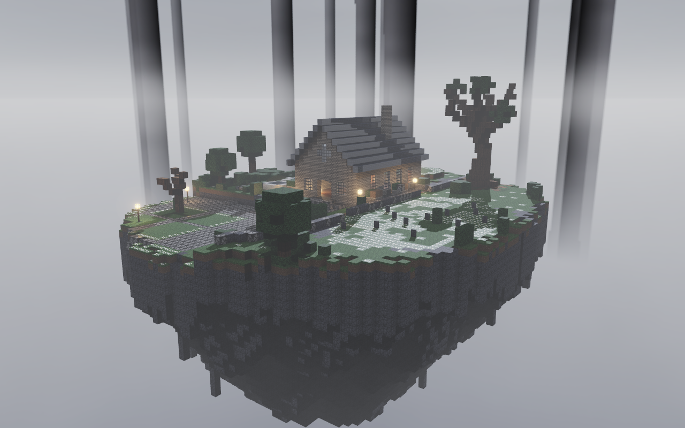
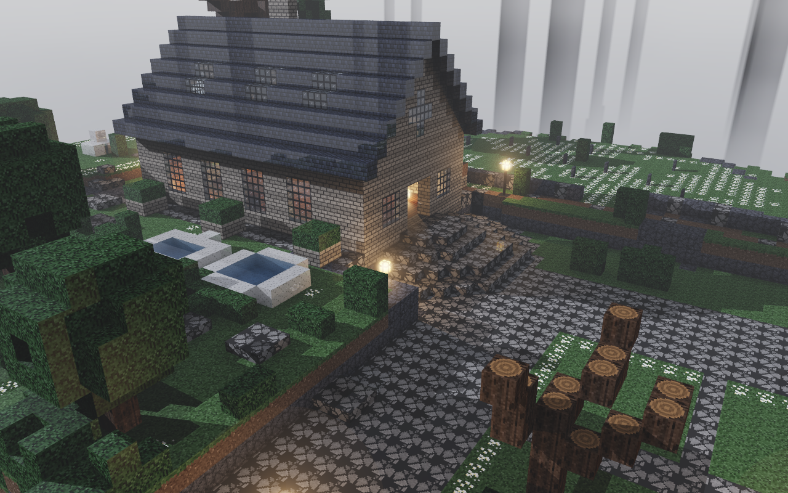

# El Sueño del Cazador: Diorama con Raytracing

Diorama de cubos texturizados inspirado en el *Hunter's Dream* de **Bloodborne**, renderizado con un **raytracer en CPU escrito desde cero en Rust**.

La escena es una isla flotante sobre un mar de niebla, rodeada de pilares gigantes, con:

- el taller/iglesia al centro;
- el gran árbol de raíces retorcidas;
- el campo de flores blancas con lápidas, que junto con el árbol forma una zona encerrada por un muro de piedra;
- el círculo de piedra con su altar;
- las fuentes de mármol con agua;
- la plaza baja con su escalera semicircular;
- los faroles encendidos, con su resplandor en la niebla.

> **Video del diorama:** *(arrastra aquí `diorama.mp4` al editar este README en GitHub)*




---

## Cómo ejecutar

```bash
cargo run --release
```

> Usa siempre `--release`: en modo debug el raytracer es mucho más lento.

### Controles

| Tecla | Acción |
|---|---|
| `A` / `D` o `←` / `→` | Rotar alrededor del diorama |
| `W` / `S` o `↑` / `↓` | Inclinar la cámara (se puede ver la isla desde abajo) |
| Arrastrar con el mouse | Rotar |
| Rueda del mouse o `Q` / `E` | Acercar / alejar (zoom) |
| `R` | Rotación automática |
| `C` | Reiniciar cámara |
| `P` | Captura en alta calidad (`diorama.png`, 1280×800, 16 muestras) |
| `V` | Grabar video (300 frames en `video_frames/`) |
| `H` | Ocultar la ayuda |

Mientras la cámara se mueve, se renderiza a 320×200. Cuando se detiene, pasa a 640×400 y la imagen **se refina progresivamente**: cada frame suma una muestra con *jitter*, lo que da antialiasing.

### Grabar el video

1. Presiona `V`. Se genera una vuelta completa de 360° con acercamiento y alejamiento: 300 frames a 1280×800.
2. Une los frames con ffmpeg:

```bash
ffmpeg -framerate 30 -i video_frames/frame_%04d.png -c:v libx264 -pix_fmt yuv420p diorama.mp4
```

---

## Rúbrica

| Criterio | Implementación |
|---|---|
| **Complejidad de la escena** | Unos 69,000 cubos en una cuadrícula de 64×58×86: isla flotante con silueta trazada sobre el mapa de referencia, parte inferior rocosa con estalactitas, taller con techo a dos aguas, frontones, rosetones, tragaluces, chimenea e interior amueblado, árbol procedural con ramas y raíces en espiral, escalera semicircular de medios bloques, jardín, caminos, muro de piedra, lápidas, fuentes, arbustos y 12 faroles |
| **Atractivo visual** | Luz de luna con sombras, luz cálida y resplandor de los faroles en la niebla, oclusión ambiental estilo Minecraft, niebla, tone mapping ACES y antialiasing progresivo |
| **Rotación y zoom** | Cámara orbital (yaw/pitch) con acercamiento y alejamiento (`camera.rs`) |
| **Materiales (5+)** | 14 materiales, cada uno con su textura y sus propios `albedo`, `specular`, `transparency` y `reflectivity` (ver tabla) |
| **Refracción** | **Vidrio** de las ventanas, rosetones y tragaluces del taller (se ve el interior iluminado a través de ellos), y **agua** de las fuentes. Ley de Snell + Fresnel (Schlick), reflexión interna total y absorción por profundidad |
| **Reflexión** | **Mármol pulido** (altar y fuentes), **tejas**, reflejo de Fresnel en **agua** y **vidrio** |
| **Skybox** | Cubemap de 6 imágenes (`assets/skybox/`): cielo gris, mar de niebla y pilares gigantes que se pierden en la neblina, como en el juego. La luna coincide con la dirección de la luz principal (`skybox.rs`) |

### Materiales

| Material | Textura | albedo [dif, spec] | specular | transparency | reflectivity | ior |
|---|---|---|---|---|---|---|
| Piedra oscura | `rock` | [0.90, 0.10] | 12 | 0 | 0 | — |
| Musgo | `grass_top` / `grass_side` | [0.95, 0.05] | 6 | 0 | 0 | — |
| Flores blancas | `flowers_top` | [0.92, 0.25] | 20 | 0 | 0 | — |
| Adoquín | `cobble` | [0.85, 0.20] | 18 | 0 | 0.03 | — |
| Madera | `planks` | [0.88, 0.20] | 25 | 0 | 0 | — |
| Ladrillo gótico | `bricks` | [0.90, 0.10] | 10 | 0 | 0 | — |
| Tejas de pizarra | `roof` | [0.70, 0.45] | 60 | 0 | 0.10 | — |
| **Vidrio** | `glass` | [0.20, 0.80] | 125 | **0.90** | 0.06 | **1.50** |
| **Agua** | `water` | [0.30, 0.70] | 150 | **0.80** | 0.10 | **1.33** |
| Corteza | `log_side` / `log_top` | [0.95, 0.05] | 5 | 0 | 0 | — |
| Hojas | `leaves` | [0.90, 0.10] | 8 | 0 | 0 | — |
| Farol (emisivo) | `lantern` | [1.00, 0.00] | 1 | 0 | 0 | — |
| **Mármol pulido** | `marble` | [0.60, 0.60] | 90 | 0 | **0.35** | — |
| Tierra | `dirt` | [0.95, 0.05] | 4 | 0 | 0 | — |

En el vidrio, el marco de hierro de la textura es opaco: el alpha de la textura modula la transparencia.

---

## Cómo funciona

- **DDA 3D** (`world.rs`): el rayo no se prueba contra los 69 mil cubos. Avanza celda por celda por la cuadrícula, como un raycaster pero en 3D, así que el costo casi no depende del tamaño de la escena. Algunos bloques usan cajas más pequeñas dentro de su celda: losas, lápidas, faroles y postes.
- **Sombreado** (`renderer.rs`): Phong con luz de luna direccional y sombras. Los faroles son luces puntuales con atenuación y sombras. La luz ambiental es un hemisferio, con oclusión ambiental por vértice y visibilidad del cielo, de modo que el interior del taller es oscuro.
- **Reflexión y refracción recursivas**: hasta 5 rebotes. El rayo lleva el medio en el que viaja (aire, agua o vidrio), así que sabe cuándo entra y cuándo sale y cambia el índice de refracción según corresponda.
- **Paralelismo** con `std::thread::scope`: las filas se reparten dinámicamente entre todos los núcleos.
- **Sin librerías externas para el raytracing**: vectores, intersecciones, texturas, skybox, ruido procedural e iluminación están implementados a mano. `raylib` solo se usa para la ventana, el input, decodificar y guardar PNG, y mostrar el framebuffer.

### Estructura

```
src/
  main.rs      ventana, input, modos de captura y video
  math.rs      Vec3, reflect, refract, fresnel, ruido
  ray.rs       rayo
  camera.rs    cámara orbital
  world.rs     vóxeles, tipos de bloque, DDA, rayos de sombra
  material.rs  materiales y sus parámetros
  texture.rs   muestreo de texturas
  skybox.rs    cubemap
  scene.rs     construcción del diorama
  renderer.rs  trazado, iluminación, acumulación, tone mapping
assets/
  textures/    texturas 16×16
  skybox/      6 caras del cielo
tools/
  generate_assets.py  generador de texturas y skybox (numpy + pillow)
```
